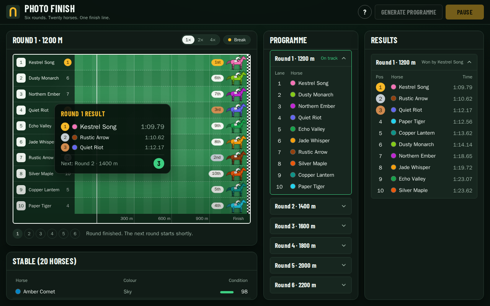
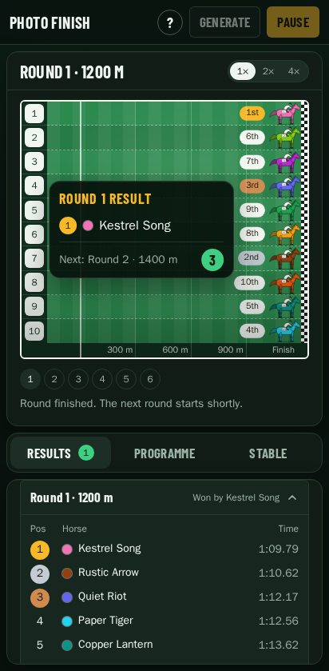

# Photo Finish

An interactive horse racing game built with Vue 3, Pinia and TypeScript.

**[Play it live](https://photo-finish.sinemaar1.workers.dev/)**

Generate a six-round programme from a stable of twenty horses, start the meeting and watch each round play out on the track, with results appearing as every round finishes.

| Desktop                                                                                                                                                                                                 | Phone                                                                                                                                    |
| ------------------------------------------------------------------------------------------------------------------------------------------------------------------------------------------------------- | ---------------------------------------------------------------------------------------------------------------------------------------- |
|  |  |

## Contents

- [Requirements covered](#requirements-covered)
- [Getting started](#getting-started)
- [Architecture](#architecture)
- [Experience](#experience)
- [Testing](#testing)
- [Performance](#performance)
- [Assumptions](#assumptions)
- [Project structure](#project-structure)
- [How the work was organised](#how-the-work-was-organised)
- [What could come next](#what-could-come-next)

## Requirements covered

| Requirement                                                | Where                                                                        |
| ---------------------------------------------------------- | ---------------------------------------------------------------------------- |
| 20 horses, each with a unique colour and a condition 1–100 | [`domain/stable.ts`](./src/domain/stable.ts)                                 |
| Generate creates 6 rounds of 10 random horses              | [`domain/programme.ts`](./src/domain/programme.ts)                           |
| Rounds of 1200, 1400, 1600, 1800, 2000 and 2200 m          | [`domain/config.ts`](./src/domain/config.ts)                                 |
| Start runs the rounds one at a time                        | [`stores/meeting.ts`](./src/stores/meeting.ts)                               |
| Results appear as each round finishes                      | [`components/results`](./src/components/results)                             |
| Horses move during a race                                  | [`components/track`](./src/components/track)                                 |
| State management with Pinia                                | [`stores`](./src/stores)                                                     |
| Component-based design                                     | [`components`](./src/components)                                             |
| Bonus: unit tests                                          | 255 tests next to the code they cover (`*.spec.ts`)                          |
| Bonus: E2E tests                                           | [`tests/e2e/meeting.spec.ts`](./tests/e2e/meeting.spec.ts)                   |
| Bonus: visual tests                                        | [`tests/e2e/visual.spec.ts`](./tests/e2e/visual.spec.ts), desktop and mobile |

Beyond the brief: pause and resume, playback speed, live standings, realistic finish times, a result banner and meeting summary, a phone layout, a reproducible session from a seed, and automated accessibility and performance checks. See [Experience](#experience).

## Getting started

Requires Node.js 22.18 or newer (see `.nvmrc`).

```sh
npm install
npm run dev
```

| Command                 | Description                                                         |
| ----------------------- | ------------------------------------------------------------------- |
| `npm run dev`           | Start the development server                                        |
| `npm run build`         | Type-check and build for production                                 |
| `npm run preview`       | Serve the production build locally                                  |
| `npm run lint`          | Lint with Oxlint and ESLint                                         |
| `npm run format`        | Format the codebase with Prettier                                   |
| `npm run typecheck`     | Type-check with `vue-tsc`                                           |
| `npm test`              | Run unit and component tests once                                   |
| `npm run test:coverage` | Run them with a coverage report                                     |
| `npm run test:e2e`      | Run the end-to-end, accessibility and visual tests                  |
| `npm run size`          | Check the built bundle against its size budget                      |
| `npm run perf:frames`   | Measure frame times during a race (needs `npm run preview` running) |

The end-to-end tests need a browser once: `npx playwright install chromium`.

Two URL parameters help when exploring or debugging:

- `?seed=7` fixes all randomness, so the same horses, programme and races come back every time.
- `?speed=5` plays the meeting five times faster.

## Architecture

Dependencies point one way only: components use stores and composables, which use the domain.

```
components/   What is on screen. Shows data and forwards clicks. Contains no game rule.
     ↓
stores/       What is true right now: the programme, the live round, the results.
composables/  Decides what happens next and delegates every calculation downwards.
     ↓
domain/       The rules, as pure TypeScript with no Vue import: create the stable,
              draw the programme, advance a race, rank the finishers.
```

A few decisions shape the code:

- **The rules are framework-free.** Everything in `src/domain` is a pure function, so it is tested without mounting anything and would survive a change of framework or renderer.
- **The meeting is a state machine.** It is always in exactly one of `idle`, `ready`, `running`, `paused`, `intermission` or `finished`. What each button allows and says is derived from that single value, never from separate flags.
- **Time is injected.** The store moves only when `tick(elapsedMs)` is called. One composable, `useFrameLoop`, connects it to `requestAnimationFrame`; tests call `tick` directly.
- **Randomness is seeded.** Every random choice goes through one generator, which makes a session reproducible and the tests stable.
- **The result does not depend on frame rate.** The simulation advances in fixed steps and carries leftover time over, so a slow machine or a background tab produces the same race.
- **The track is a renderer.** `RaceTrack` receives runners and their progress as props and knows nothing about stores. Horses move by `transform` alone.

The full reasoning, including the race model, is in the [product requirements](./docs/PRD.md).

## Experience

The brief is met by the first seven phases of the [roadmap](./docs/ROADMAP.md). Three more phases started from a review of that first delivery and reworked the experience.

- **Always in view.** Below 1024 px the track and the controls stay on screen, and the results, programme and stable share the space underneath behind tabs. The page itself never scrolls.
- **Lists that follow the meeting.** Rounds collapse to one line. The programme opens the round on the track; the results open the latest one and fold earlier rounds to their winner.
- **A race worth watching.** Live rank on every gate, the three leaders named under the track, horses drawn with a jockey and shaded from their one colour, and a gallop that only plays while a horse is actually running.
- **Always clear what happens next.** A banner shows the podium of the round that just finished and counts down to the next one; after the last round a summary names the horses of the day and offers a new programme.
- **In the player's hands.** Playback at 1×, 2× or 4×, a round stepper, and a welcome card on the empty track with the three steps and the main action.
- **Explained from the source.** The "How it works" dialog reads its figures from the game configuration, shows the seed of the session and links to a replay of it.
- **For everyone.** Colour is never the only cue, results are announced to screen readers once per round, the dialog traps and returns focus, every control works from the keyboard, and decorative motion stops under `prefers-reduced-motion`.

## Testing

| Layer                      | Tool                   | Count | What it proves                                                                                                                        |
| -------------------------- | ---------------------- | ----- | ------------------------------------------------------------------------------------------------------------------------------------- |
| Domain                     | Vitest                 | 47    | The rules of the brief, reproducibility from a seed, independence from frame rate, the effect of condition, the meeting summary       |
| Stores                     | Vitest                 | 51    | Every state transition, including the illegal ones being ignored; results recorded once per round; live ranks and the break countdown |
| Components and composables | Vitest, Vue Test Utils | 157   | Components render what they are given; controls are enabled and labelled by status; tabs, dialog, frame loop                          |
| End-to-end                 | Playwright             | 22    | A whole meeting in the browser, pause and resume, reset, speed, onboarding, the help dialog, keyboard-only play                       |
| Phone layout               | Playwright             | 7     | Track, controls and a list fit one screen; tabs; the first result brings its tab forward                                              |
| Accessibility              | Playwright, axe        | 7     | No serious issue in seven states, including the dialog and the result banner                                                          |
| Visual                     | Playwright             | 12    | Six states on desktop and phone, compared with committed baselines                                                                    |

Line coverage of the unit and component tests is above 99%.

The browser tests take control of the page's clock: time moves only when a test advances it. A given seed therefore replays frame for frame, a full meeting runs in a few seconds, and no test waits on real time. Visual baselines are generated and compared in the CI container, because screenshots depend on the fonts of the machine; elsewhere the comparison is skipped.

CI runs lint, formatting, type-check, unit tests and build in one job and the browser tests in another, on every pull request.

## Performance

| Measure                   | Result                                                        | How                                              |
| ------------------------- | ------------------------------------------------------------- | ------------------------------------------------ |
| Lighthouse performance    | 100                                                           | Mobile profile with throttling, production build |
| Lighthouse accessibility  | 100                                                           | Same run                                         |
| Lighthouse best practices | 100                                                           | Same run                                         |
| Largest contentful paint  | 1.1 s                                                         | Same run                                         |
| Total blocking time       | 30 ms                                                         | Same run                                         |
| Layout shift              | 0                                                             | Same run                                         |
| Frame time during a race  | 16.7 ms on average and at the 95th percentile, no long frames | `npm run perf:frames`, 360 frames at 1440 × 900  |
| JavaScript shipped        | 40.5 kB gzip                                                  | `npm run size`; CI fails above 60 kB             |
| CSS shipped               | 6.0 kB gzip                                                   | `npm run size`; CI fails above 10 kB             |

What keeps it fast:

- Horses move by `transform` alone, so a frame costs no layout work.
- The live round state is immutable and held in a `shallowRef`; a tick replaces one reference instead of triggering deep reactivity.
- The simulation is a handful of multiplications per horse per step, and the frame loop only runs while the clock does.
- The only runtime dependencies are Vue and Pinia. The display typeface is bundled, so nothing is fetched from another origin.

## Assumptions

The brief leaves some points open. These are the decisions taken; each is isolated in the code and easy to change.

| Open point                                                      | Decision                                                                            |
| --------------------------------------------------------------- | ----------------------------------------------------------------------------------- |
| "Between 1 and 20 horses" versus "a total of 20 horses"         | Always 20. A round needs 10, so fewer could never work. The size is one constant.   |
| What the condition score does                                   | It raises a horse's average speed. Form on the day and surges keep upsets possible. |
| The example shows "Start / Pause", the text only mentions Start | One control that starts, pauses and resumes.                                        |
| Generating while a race is running                              | Disabled during a round; allowed when paused or finished, which resets the results. |
| Moving from one round to the next                               | Automatic after a short break.                                                      |
| A 2200 m race takes over two minutes in reality                 | Played back nine times faster; finish times are still reported in real race time.   |

## Project structure

```
src/
  domain/         Game rules: config, rng, stable, programme, simulation, types
  stores/         Pinia stores: session, stable, meeting
  composables/    useFrameLoop, useRevealInScroller, useAutoExpand, useMediaQuery
  components/
    ui/           BaseButton, BasePanel, BaseTabs, BaseDialog
    shared/       HorseBadge, RoundCard
    layout/       AppHeader
    stable/  programme/  results/  track/  help/
  config/         Playback settings
  utils/          Formatting, URL options
  styles/         Design tokens and base styles
tests/e2e/        Playwright specs, page object and visual baselines
scripts/          Bundle size budget and frame-timing measurement
docs/             Product requirements and roadmap
```

## How the work was organised

The project started with a [product requirements document](./docs/PRD.md) and a [roadmap](./docs/ROADMAP.md) that splits the work into phases. Each phase was built on its own branch, reviewed as a pull request with a description of what changed and how it was verified, and merged only with CI green. The [closed pull requests](../../pulls?q=is%3Apr+is%3Aclosed) tell the story in order.

## What could come next

- Pausing during the break between rounds
- A second, 3D renderer behind the same `RaceTrack` props
- Translations, by moving the interface strings into message files
- Keeping past meetings, which would add persistence to the session store
