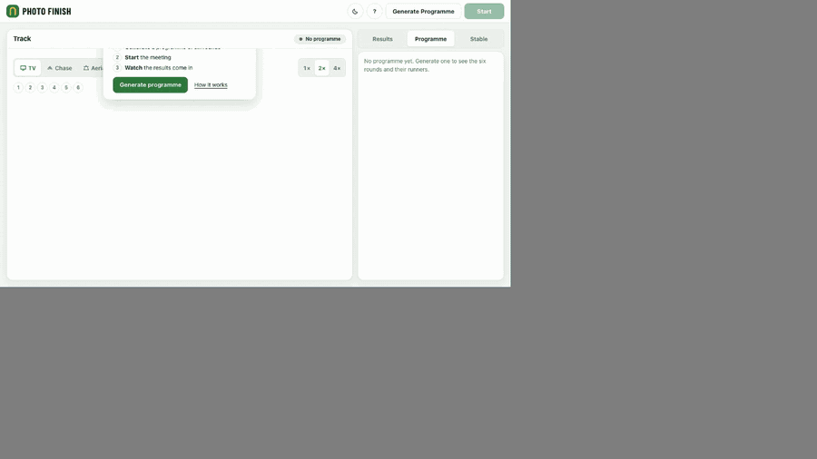
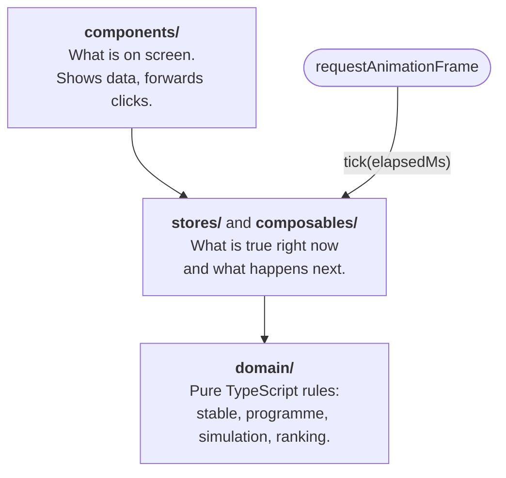
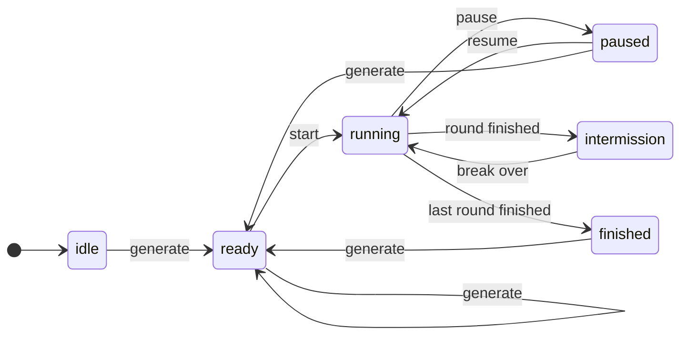

<h1 align="center">Photo Finish</h1>

<p align="center">
  An interactive horse racing game built with Vue 3, Pinia and TypeScript.<br />
  Six rounds. Twenty horses. One finish line.
</p>

<p align="center">
  <a href="https://photo-finish.sinemaar1.workers.dev/"><strong>Play it live</strong></a>
  ·
  <a href="./docs/PRD.md">Product requirements</a>
  ·
  <a href="./docs/ROADMAP.md">Roadmap</a>
  ·
  <a href="https://github.com/sinemagar/photo-finish/pulls?q=is%3Apr+is%3Aclosed">Pull requests</a>
</p>

<p align="center">
  <a href="https://github.com/sinemagar/photo-finish/actions/workflows/ci.yml"></a>
  
  
  
  
  
</p>

<p align="center">
  
</p>

---

## Contents

- [At a glance](#at-a-glance)
- [Requirements covered](#requirements-covered)
- [Getting started](#getting-started)
- [Architecture](#architecture)
- [Testing](#testing)
- [Performance](#performance)
- [Assumptions](#assumptions)
- [How it was built](#how-it-was-built)
- [Project structure](#project-structure)
- [What could come next](#what-could-come-next)

## At a glance

<table>
  <tr>
    <td width="32%" valign="top">
      
    </td>
    <td valign="top">
      
    </td>
  </tr>
  <tr>
    <td valign="top"><strong>On a phone</strong><br />Track and controls stay in view; the lists sit behind tabs and the results come forward by themselves.</td>
    <td valign="top"><strong>End of the meeting</strong><br />After six rounds a summary names the horses of the day and offers a new programme.</td>
  </tr>
</table>

|                              |                                                                                                                               |
| ---------------------------- | ----------------------------------------------------------------------------------------------------------------------------- |
| **Live race**                | Live rank on every gate, the three leaders named under the track, a gallop that only plays while a horse is running           |
| **Always clear what's next** | A podium banner with a countdown between rounds, a round stepper, collapsible rounds that follow the meeting                  |
| **In your hands**            | Start, pause and resume; playback at 1×, 2× or 4×; a welcome card and a "How it works" dialog                                 |
| **Reproducible**             | Every session runs on a seed. `?seed=7` brings back the same horses, programme and races                                      |
| **For everyone**             | Keyboard-only play, screen-reader announcements once per round, colour never the only cue, `prefers-reduced-motion` respected |

## Requirements covered

Every point of the brief, and where to find it in the code.

| Requirement                                                | Where                                                                        |
| ---------------------------------------------------------- | ---------------------------------------------------------------------------- |
| 20 horses, each with a unique colour and a condition 1–100 | [`domain/stable.ts`](./src/domain/stable.ts)                                 |
| Generate creates 6 rounds of 10 random horses              | [`domain/programme.ts`](./src/domain/programme.ts)                           |
| Rounds of 1200, 1400, 1600, 1800, 2000 and 2200 m          | [`domain/config.ts`](./src/domain/config.ts)                                 |
| Start runs the rounds one at a time                        | [`stores/meeting.ts`](./src/stores/meeting.ts)                               |
| Results appear as each round finishes                      | [`components/results`](./src/components/results)                             |
| Horses move during a race                                  | [`components/track`](./src/components/track)                                 |
| State management with Pinia                                | [`stores`](./src/stores)                                                     |
| Component-based design                                     | [`components`](./src/components)                                             |
| Bonus: unit tests                                          | 255 tests next to the code they cover (`*.spec.ts`)                          |
| Bonus: E2E tests                                           | [`tests/e2e/meeting.spec.ts`](./tests/e2e/meeting.spec.ts)                   |
| Bonus: visual tests                                        | [`tests/e2e/visual.spec.ts`](./tests/e2e/visual.spec.ts), desktop and mobile |

## Getting started

### Try it

Open **[photo-finish.sinemaar1.workers.dev](https://photo-finish.sinemaar1.workers.dev/)**, press **Generate programme**, then **Start**.

### Run it locally

You need [Node.js](https://nodejs.org/) 22.18 or newer (see `.nvmrc`) and npm.

```sh
# 1. Get the code
git clone https://github.com/sinemagar/photo-finish.git
cd photo-finish

# 2. Install dependencies
npm install

# 3. Start the development server, then open http://localhost:5173
npm run dev
```

To run the browser tests, install their browser once:

```sh
npx playwright install chromium
npm run test:e2e
```

### Scripts

| Command                 | Description                                                         |
| ----------------------- | ------------------------------------------------------------------- |
| `npm run dev`           | Start the development server                                        |
| `npm run build`         | Type-check and build for production                                 |
| `npm run preview`       | Serve the production build locally                                  |
| `npm run lint`          | Lint with Oxlint and ESLint                                         |
| `npm run format`        | Format the codebase with Prettier                                   |
| `npm run typecheck`     | Type-check with `vue-tsc`                                           |
| `npm test`              | Run unit and component tests once                                   |
| `npm run test:coverage` | Run them with a coverage report                                     |
| `npm run test:e2e`      | Run the end-to-end, accessibility and visual tests                  |
| `npm run size`          | Check the built bundle against its size budget                      |
| `npm run perf:frames`   | Measure frame times during a race (needs `npm run preview` running) |

### URL parameters

| Parameter  | Effect                                                                |
| ---------- | --------------------------------------------------------------------- |
| `?seed=7`  | Fixes all randomness: the same horses, programme and races every time |
| `?speed=4` | Plays the meeting four times faster (the speed control does the same) |

### Deployment

The site is a static build hosted on Cloudflare. Every merge to `main` is built and deployed automatically; no configuration is needed beyond the build command `npm run build` and the output folder `dist`.

## Architecture

Dependencies point one way only. Components never contain a game rule, and the rules never import Vue.



The meeting is a state machine. Every button's label and enabled state is derived from this one value, never from separate flags.



Decisions that shape the code:

- **The rules are framework-free.** Everything in `src/domain` is a pure function, tested without mounting anything.
- **Stores orchestrate, the domain computes.** A store action calls a domain function and keeps the result.
- **Time is injected.** The store moves only when `tick(elapsedMs)` is called. One composable, `useFrameLoop`, connects it to the browser; tests call `tick` directly.
- **Randomness is seeded.** One generator for every random choice makes sessions reproducible and tests stable.
- **The result does not depend on frame rate.** The simulation advances in fixed steps and carries leftover time over, so a slow machine or a background tab produces the same race. A unit test proves it.
- **The track is a renderer.** `RaceTrack` takes runners and their progress as props and knows nothing about stores. Horses move by `transform` alone.

The full reasoning, including the race model, is in the [product requirements](./docs/PRD.md).

## Testing

**303 tests**, all running in CI on every pull request.

| Layer                      | Tool                   | Count | What it proves                                                                                                                        |
| -------------------------- | ---------------------- | ----- | ------------------------------------------------------------------------------------------------------------------------------------- |
| Domain                     | Vitest                 | 47    | The rules of the brief, reproducibility from a seed, independence from frame rate, the effect of condition, the meeting summary       |
| Stores                     | Vitest                 | 51    | Every state transition, including the illegal ones being ignored; results recorded once per round; live ranks and the break countdown |
| Components and composables | Vitest, Vue Test Utils | 157   | Components render what they are given; controls are enabled and labelled by status; tabs, dialog, frame loop                          |
| End-to-end                 | Playwright             | 22    | A whole meeting in the browser, pause and resume, reset, speed, onboarding, the help dialog, keyboard-only play                       |
| Phone layout               | Playwright             | 7     | Track, controls and a list fit one screen; tabs; the first result brings its tab forward                                              |
| Accessibility              | Playwright, axe        | 7     | No serious issue in seven states, including the dialog and the result banner                                                          |
| Visual                     | Playwright             | 12    | Six states on desktop and phone, compared with committed baselines                                                                    |

Line coverage of the unit and component tests is above 99%.

**How the browser tests stay deterministic.** They take control of the page's clock: time moves only when a test advances it. With a fixed seed a meeting replays frame for frame, a whole 85-second meeting runs in a few seconds, and no test waits on real time. Visual baselines are produced and compared in the CI container, because screenshots depend on the fonts of the machine.

**Tests that paid off.** The accessibility checks found panels that could not be scrolled from the keyboard and low-contrast text in finished rounds; a unit test caught a rounding bug in the condition meter; the first visual baseline exposed a squeezed track at 1280 px. All were fixed in the same pull request that found them.

## Performance

| Measure                                     | Result                                              |
| ------------------------------------------- | --------------------------------------------------- |
| Lighthouse performance / a11y / best pract. | 100 / 100 / 100 (mobile profile, production build)  |
| Largest contentful paint                    | 1.1 s                                               |
| Total blocking time                         | 30 ms                                               |
| Layout shift                                | 0                                                   |
| Frame time during a race                    | 16.7 ms average and 95th percentile, no long frames |
| JavaScript shipped                          | 40.5 kB gzip (CI fails above 60 kB)                 |
| CSS shipped                                 | 6.0 kB gzip (CI fails above 10 kB)                  |

What keeps it fast:

- Horses move by `transform` alone, so a frame costs no layout work.
- The live round state is immutable and held in a `shallowRef`; a tick replaces one reference instead of triggering deep reactivity.
- The frame loop only runs while the clock does.
- The only runtime dependencies are Vue and Pinia. The display typeface is bundled, so nothing is fetched from another origin.

## Assumptions

The brief leaves some points open. These are the decisions taken; each is isolated in the code and easy to change.

| Open point                                                      | Decision                                                                            |
| --------------------------------------------------------------- | ----------------------------------------------------------------------------------- |
| "Between 1 and 20 horses" versus "a total of 20 horses"         | Always 20. A round needs 10, so fewer could never work. The size is one constant.   |
| What the condition score does                                   | It raises a horse's average speed. Form on the day and surges keep upsets possible. |
| The example shows "Start / Pause", the text only mentions Start | One control that starts, pauses and resumes.                                        |
| Generating while a race is running                              | Disabled during a round; allowed when paused or finished, which resets the results. |
| Moving from one round to the next                               | Automatic after a short break.                                                      |
| A 2200 m race takes over two minutes in reality                 | Played back nine times faster; finish times are still reported in real race time.   |

## How it was built

### Plan first, then phases

The work started with a [product requirements document](./docs/PRD.md) and a [roadmap](./docs/ROADMAP.md), before any code. Each phase was built on its own branch and merged through a pull request that says what changed, why, and how it was verified, with CI green. The [closed pull requests](https://github.com/sinemagar/photo-finish/pulls?q=is%3Apr+is%3Aclosed) tell the story in order:

| Phases | Outcome                                                                                                                          |
| ------ | -------------------------------------------------------------------------------------------------------------------------------- |
| 0–2    | Tooling and CI, the rules as pure TypeScript, Pinia stores and the state machine                                                 |
| 3–4    | A working interface, then the animated track: every requirement of the brief met                                                 |
| 5–7    | Visual design, end-to-end, accessibility and visual tests, deployment                                                            |
| 8–10   | A review of the first delivery, then a new visual language, the phone layout, live standings, onboarding and performance budgets |

### Working with Claude

I used [Claude Code](https://claude.com/claude-code) as a pair programmer throughout, the same way I use AI tools in my day-to-day work. It helped me most with:

- **Planning:** turning the brief into the PRD and the phased roadmap, and spotting the ambiguities worth deciding up front.
- **Infrastructure:** project scaffolding, the CI workflow, the Playwright set-up with a controlled clock, and the deployment.
- **Design and visualisation:** iterating on the theme, layout and SVG artwork, and reviewing screenshots at several screen sizes.
- **Tests:** drafting test cases alongside each feature, which I then extended and kept green.

I set the direction and the priorities, decided between the options it proposed, reviewed every pull request, and checked each phase in the browser on desktop and phone before merging. Nothing was merged on trust: every change had to pass lint, type-check, the unit tests and the browser tests in CI. Being able to explain each decision in this repository was the bar.

## Project structure

```
src/
  domain/         Game rules: config, rng, stable, programme, simulation, summary, types
  stores/         Pinia stores: session, stable, meeting
  composables/    useFrameLoop, useRevealInScroller, useAutoExpand, useMediaQuery
  components/
    ui/           BaseButton, BasePanel, BaseTabs, BaseDialog
    shared/       HorseBadge, RoundCard
    layout/       AppHeader
    stable/  programme/  results/  track/  help/
  config/         Playback settings
  utils/          Formatting, URL options
  styles/         Design tokens and base styles
tests/e2e/        Playwright specs, page object and visual baselines
scripts/          Bundle size budget and frame-timing measurement
docs/             Product requirements, roadmap, screenshots and recordings
```

## What could come next

- Pausing during the break between rounds
- A second, 3D renderer behind the same `RaceTrack` props
- Translations, by moving the interface strings into message files
- Keeping past meetings, which would add persistence to the session store
